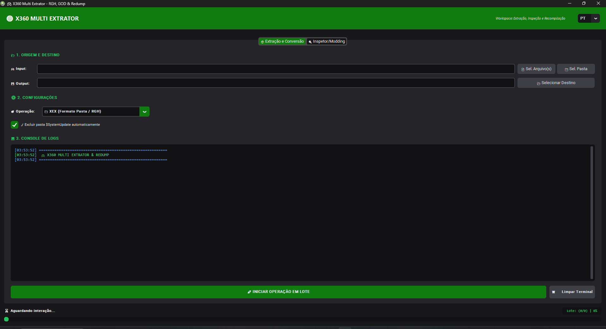
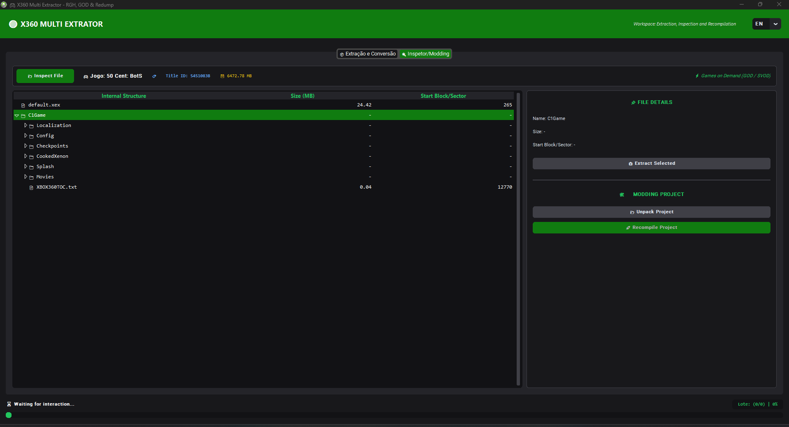

# 🎮 X360 Multi Extrator

A modern, high-performance desktop utility designed to extract, inspect, and convert Xbox 360 game images and packages (XEX, GOD, STFS, and GDFX). Built with a streamlined Xbox dark-mode interface and full internationalization.

---

## 📸 Interface Preview

### 1. Batch Extraction & Conversion Hub
Process individual disc images or entire directories in bulk, strip unnecessary system updates, and monitor operation progress via live terminal output.

---

### 2. Deep Container Inspector & Modding Workspace
Inspect raw archive nodes, analyze Title IDs and sector offsets, extract isolated assets, or unpack complete modding structures.

---

## ✨ Features

- **Multi-Format Extraction:**
  - **ISO to XEX:** Extracts raw disc filesystems (`default.xex` and assets) optimized for Aurora, FSD, and the **Xenia** PC emulator.
  - **ISO to GOD (Games on Demand):** Converts standard `.iso` images into numeric container structures (`00007000/...`) for direct installation on console hard drives.
- **Batch Processing:** Scan full folders and queue multiple titles sequentially with real-time logging.
- **Automated Partition Trimming:** Automatically detects and strips `$SystemUpdate` folders to save hundreds of megabytes per title.
- **Interactive Tree Inspector:** Explore STFS and GDFX internal file hierarchies without extracting the entire archive.
- **Modding Project Export:** Export individual assets or unpack entire game trees ready for asset modification and recompilation.
- **Native Internationalization (i18n):** Automated system language detection with on-the-fly switching between **English (EN)**, **Portuguese (PT)**, and **Spanish (ES)**.

---

## 🚀 Getting Started

### Downloading the Standalone Binary
Pre-compiled 64-bit binaries are available on the [Releases](https://github.com/TheAlpha242/X360-Multi-Extrator/releases) page. No Python installation or runtime setup is required.

1. Download `X360-Multi-Extrator-v1.0.0-win64.zip` from the latest release.
2. Extract the archive contents.
3. Launch `X360-Multi-Extrator.exe`.

---

## 🛠️ Usage Guide

### Extracting Games to Folder Format (XEX / Emulator)
1. Select the **Extração e Conversão** (Extraction & Conversion) tab.
2. Under **1. Origem e Destino**, select your source file (`.iso`) or folder using **Sel. Arquivo(s)** / **Sel. Pasta**.
3. Choose the target destination directory with **Selecionar Destino**.
4. In **2. Configurações**, set the operation mode to **XEX (Formato Pasta / RGH)**.
5. (Optional) Check **Excluir pasta $SystemUpdate automaticamente** to discard system update files.
6. Click **Iniciar Operação em Lote** to begin processing.

### Inspecting Archives & Exporting Assets
1. Switch to the **Inspetor/Modding** tab.
2. Click **Inspect File** and open an Xbox 360 container or ISO.
3. View internal file hierarchies, sector blocks, Title ID, and game metadata.
4. Select any asset in the tree view and click **Extract Selected** to extract it individually, or click **Unpack Project** for a full modding workspace.

---

## 💻 System Requirements

- **Operating System:** Windows 10 / Windows 11 (64-bit)
- **Processor:** Dual-core 2.0 GHz or higher
- **Memory:** 4 GB RAM minimum
- **Disk Space:** Required storage varies based on target ISO sizes (typically 7–16 GB per game)

---

## 📜 License & Credits

Developed by **TheAlpha242**. Built using Python, CustomTkinter, and specialized extraction modules for Xbox 360 disk formats.